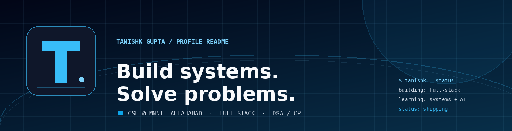
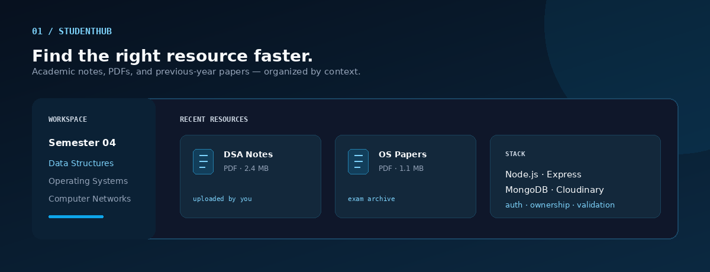
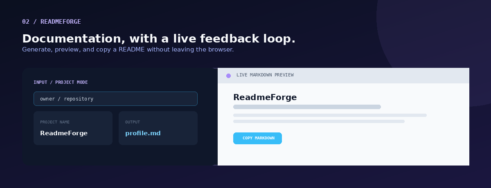
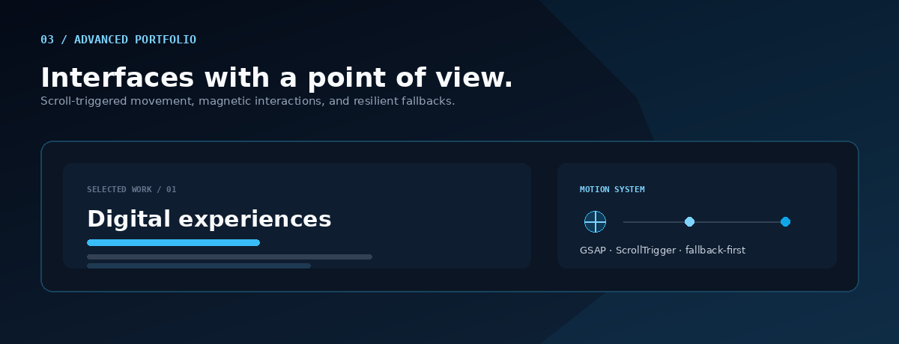
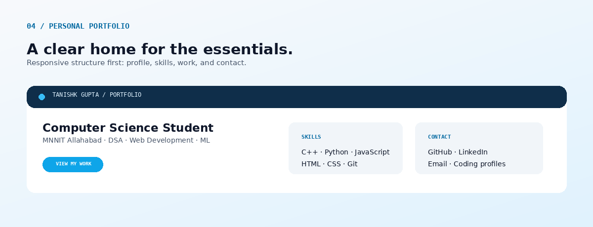

<div align="center">

<a href="https://github.com/tan-ishk007">
  
</a>

<p>
  <a href="https://github.com/tan-ishk007">GitHub</a>
  <span> · </span>
  <a href="https://linkedin.com/in/tanishk-gupta-168506375">LinkedIn</a>
  <span> · </span>
  <a href="mailto:guptatanishk007@gmail.com">Email</a>
  <span> · </span>
  <a href="https://leetcode.com/u/tan_ishk_007/">LeetCode</a>
  <span> · </span>
  <a href="https://codeforces.com/profile/tan__ishk__007">Codeforces</a>
</p>

</div>

<p align="center">
  <a href="#selected-work">Selected work</a> ·
  <a href="#engineering-lens">Engineering lens</a> ·
  <a href="#stack">Stack</a> ·
  <a href="#problem-solving">Problem solving</a> ·
  <a href="#now-next">Now / next</a> ·
  <a href="#contact">Contact</a>
</p>

<br />

<table>
<tr>
<td width="62%" valign="top">

## `whoami`

I’m **Tanishk Gupta**, a Computer Science & Engineering student at **MNNIT Allahabad**. I build full-stack applications, practice competitive programming, and keep moving toward the deeper parts of software engineering: reliable APIs, clear data flow, system design, and intelligent products.

My north star is simple: **make the problem clearer, make the software useful, and make the next iteration easier.**

</td>
<td width="38%" valign="top">

## `status`

```text
● building     full-stack
● sharpening   DSA / CP
● exploring    AI / ML
● learning     systems
```

</td>
</tr>
</table>

## Selected Work

Projects are the center of this profile because they show the decisions behind the tools.

<table>
<tr>
<td width="50%" valign="top">

<a href="https://studenthub-4io3.onrender.com">
  
</a>

### StudentHub

**A resource-sharing platform for students.**

Upload, organize, and discover notes, PDFs, and previous-year papers by semester and subject.

`Node.js` `Express.js` `MongoDB` `Mongoose`  
`EJS` `Bootstrap` `Cloudinary` `GSAP`

[Live demo ↗](https://studenthub-4io3.onrender.com) · [Repository ↗](https://github.com/tan-ishk007/studenthub)

<details>
<summary>Build notes</summary>

Session-based authentication, bcrypt, ownership-aware access control, Cloudinary uploads, admin privileges, validation, profile management, flash messaging, and responsive UI.

</details>

</td>
<td width="50%" valign="top">

<a href="https://tan-ishk007.github.io/readme-forge/">
  
</a>

### ReadmeForge

**Documentation, with a live feedback loop.**

An AI-assisted GitHub README generator with profile and repository modes, live Markdown preview, GitHub import, and one-click copy.

`HTML` `CSS` `JavaScript`  
`GitHub REST API` `Markdown`

[Live demo ↗](https://tan-ishk007.github.io/readme-forge/) · [Repository ↗](https://github.com/tan-ishk007/readme-forge)

<details>
<summary>Build notes</summary>

Repository-aware input, structured README generation, a browser-based GFM preview, automatic badge generation, and an interface designed around immediate visual feedback.

</details>

</td>
</tr>
</table>

<table>
<tr>
<td width="50%" valign="top">

<a href="https://tan-ishk007.github.io/portfolio/">
  
</a>

### Advanced Portfolio

**Interfaces with a point of view.**

A scroll-animated portfolio with layered micro-interactions, magnetic buttons, and fallback-first behavior.

`HTML` `CSS` `JavaScript`  
`GSAP` `ScrollTrigger`

[Live demo ↗](https://tan-ishk007.github.io/portfolio/) · [Repository ↗](https://github.com/tan-ishk007/portfolio)

</td>
<td width="50%" valign="top">

<a href="https://tan-ishk007.github.io/v1-portfolio/">
  
</a>

### Personal Portfolio

**A clear home for the essentials.**

A responsive portfolio built from scratch for academic details, skills, coding profiles, and contact information.

`HTML` `CSS` `GitHub Pages`

[Live demo ↗](https://tan-ishk007.github.io/v1-portfolio/) · [Repository ↗](https://github.com/tan-ishk007/v1-portfolio)

</td>
</tr>
</table>

## Engineering Lens

```text
01  CLARITY        understand the problem before the implementation
02  BOUNDARIES     keep responsibilities easy to change
03  FEEDBACK       make every important state visible to the user
04  RESILIENCE     design for bad input and missing dependencies
05  ITERATION      leave the codebase better positioned for the next idea
```

<details>
<summary><strong>My shipping loop</strong></summary>

`idea` → `shape` → `design` → `implement` → `test` → `deploy` → `iterate`

The framework is only one layer. I care about the decisions around it: what belongs where, how failure is communicated, and whether the result remains understandable after the excitement of the first build wears off.

</details>

## Stack

<p align="center">
  
  <br />
  <sub>CORE LANGUAGES</sub>
</p>

<p align="center">
  
  <br />
  <sub>WEB / SERVER</sub>
</p>

<p align="center">
  
  <br />
  <sub>DATA / ENGINEERING TOOLING</sub>
</p>

<table>
<tr>
<td width="33%" valign="top">

**Strongest signal**  
C / C++ · Python · JavaScript

</td>
<td width="33%" valign="top">

**Building with**  
Node.js · Express · MongoDB

</td>
<td width="33%" valign="top">

**Exploring next**  
React · Next.js · AI / ML · Cloud

</td>
</tr>
</table>

## Problem Solving

Competitive programming is part of my engineering practice: constraints make assumptions visible, and edge cases make design honest.

<table>
<tr>
<td width="50%" valign="top">

### LeetCode

# `240+`

problems solved  
contest rating **1572**

<a href="https://leetcode.com/u/tan_ishk_007/">Open profile ↗</a>

</td>
<td width="50%" valign="top">

### Codeforces

# `1130`

current rating  
peak **1131**

<a href="https://codeforces.com/profile/tan__ishk__007">Open profile ↗</a>

</td>
</tr>
</table>

> I’m training the part of problem solving that survives beyond a contest: modelling constraints, choosing the right abstraction, and making correctness explainable.

## Now / Next

```text
DONE                          NOW                         NEXT
───────────────────────       ─────────────────────       ─────────────────────
full-stack foundations   →     production-quality work  →   system design
responsive interfaces    →     DSA / competitive prog.  →   cloud
personal projects        →     AI / ML foundations     →   open source
```

## Proof of Progress

| Signal | Evidence |
| --- | --- |
| **Academic** | B.Tech — Computer Science & Engineering, MNNIT Allahabad · CPI **9.11 / 10** |
| **Algorithmic** | **240+** LeetCode problems · rating **1572** |
| **Competitive** | Codeforces rating **1130** · peak **1131** |
| **Creative / technical** | 3rd place in Model Aircraft Design, Aero Club |
| **Hands-on collaboration** | RoboGesture — wireless remote-controlled vehicle project |

## Activity

The native GitHub contribution graph remains the source of truth on the profile. This single summary visual adds context without duplicating it with multiple streak cards or language charts.

<p align="center">
  <a href="https://github.com/tan-ishk007">
    
  </a>
</p>

<p align="center"><a href="https://github.com/tan-ishk007">Open GitHub for the live contribution graph →</a></p>

## Education

**MNNIT Allahabad**  
B.Tech — Computer Science & Engineering  
CPI: **9.11 / 10**

## Contact

For software, systems, competitive programming, open source, or a good project idea:

<p align="center">
  <a href="mailto:guptatanishk007@gmail.com">Email</a> ·
  <a href="https://linkedin.com/in/tanishk-gupta-168506375">LinkedIn</a> ·
  <a href="https://github.com/tan-ishk007">GitHub</a> ·
  <a href="https://leetcode.com/u/tan_ishk_007/">LeetCode</a> ·
  <a href="https://codeforces.com/profile/tan__ishk__007">Codeforces</a>
</p>

<details>
<summary><strong>sudo reveal</strong></summary>

Still debugging. Still shipping.

</details>

<div align="center">

<br />

<sub>Built with intent · tuned through iteration · always one useful commit away from better</sub>

</div>
